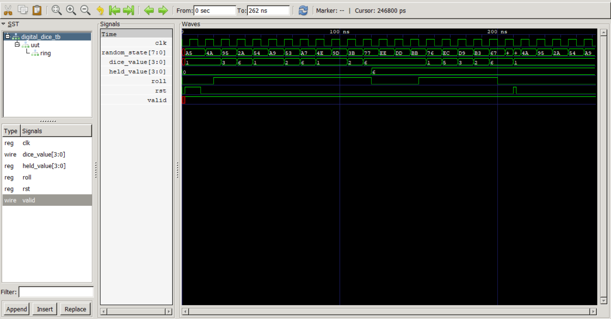
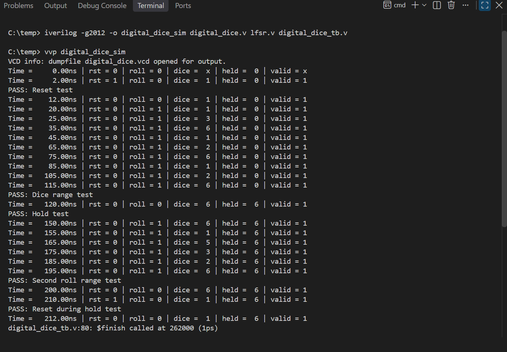

# Digital Dice — Verilog Project

A digital dice implemented in Verilog HDL using a Linear Feedback Shift Register (LFSR) to generate a pseudo-random sequence. The design simulates a six-sided dice, producing values from 1 to 6 while the roll input is active and holding the final value when rolling stops.

This project was developed as beginning of my journey into digital design and RTL development.

## Project Overview

The project started with a basic counter-style digital dice and was subsequently upgraded with an LFSR-based pseudo-random generator.

### Features

- Six-sided dice output: values 1–6.
- Clock-driven sequential logic.
- Reset support to initialize the dice output.
- LFSR-based pseudo-random state generation.
- Dice output updates while `roll` is asserted.
- Dice output holds its value when `roll` is deasserted.
- `valid` output indicates whether the dice value is within the legal range.
- Testbenches for functional verification and waveform analysis.

## Design Architecture

The design consists of three main components:

1. **LFSR (`lfsr.v`)** — updates an 8-bit pseudo-random state on clock edges.
2. **Digital Dice (`digital_dice.v`)** — maps the generated state to a legal dice value from 1 to 6 and controls rolling and holding behavior.
3. **Testbenches** — exercise the design and inspect its behavior through simulation.

The LFSR uses XOR feedback and a nonzero initial seed. The generated sequence is deterministic for a given seed; it is pseudo-random, not true randomness.

## Verification

The testbench was used to verify the following behaviors:

- Reset initializes the dice output to 1.
- Dice values remain within the range 1–6.
- The output changes while rolling is enabled.
- The output holds its value after rolling stops.
- Reset works correctly during a hold condition.

The functional testbench reported PASS for all five test scenarios.

## Simulation Evidence

### GTKWave

The waveform shows the changing LFSR state, dice output, roll control, reset, and validity signal.

### Simulation Results

The terminal output records the testbench results and PASS messages.

## Tools Used

- Verilog HDL
- Visual Studio Code
- Icarus Verilog
- GTKWave

## Learning Outcomes

Through this project, I practised:

- Writing synthesizable sequential RTL.
- Using clocked `always` blocks and reset logic.
- Understanding LFSRs and pseudo-random sequences.
- Connecting RTL modules.
- Writing testbenches and checking expected behavior.
- Inspecting simulation waveforms and debugging signal transitions.
- Organizing RTL source files, testbenches, and documentation in GitHub.

## Limitations and Future Improvements

- An LFSR is deterministic and is not a source of cryptographically secure or truly random values.
- Mapping a pseudo-random state into six outcomes should be evaluated for distribution bias if statistical fairness is important.
- Future improvements could include statistical distribution testing and implementation on an FPGA board with physical controls and a seven-segment display.

## Project Status

**Completed — functional simulation and testbench verification.**

This project is an educational digital-design exercise and is not intended for security-sensitive or safety-critical applications.
